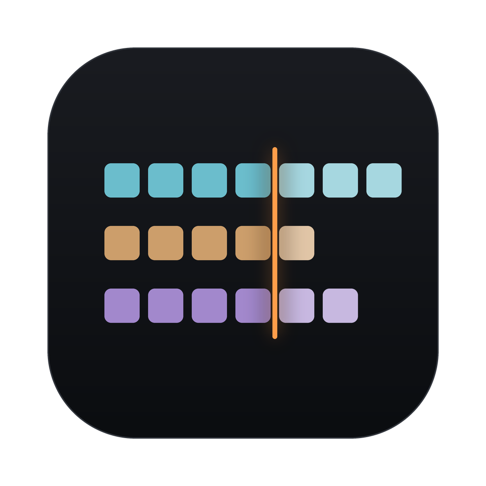

# Berlinan

A generative MIDI sequencer for macOS in the style of the 1970s **Berlin
School** — Tangerine Dream, Klaus Schulze. It plays several short melodic
loops that repeat, slowly shift against each other because their lengths
differ, and change only a little at a time, much like a jam on a hardware
modular synth.

Berlinan is a MIDI instrument, not a DAW: it publishes a virtual MIDI source
(**Berlinan Out**) and you point synths — hardware or Ableton Live tracks —
at its channels. Audio never touches it.

Website and download: https://jiripisa.github.io/berlinan/ ·
manual: https://jiripisa.github.io/berlinan/manual.html
(česky: https://jiripisa.github.io/berlinan/cs/)



## The style laws (why it sounds right)

The engine encodes the genre's rules from `berlin_school_manual.md`, compiled
from about 225 video lessons by a Berlin School practitioner (the Synth Seeker
YouTube channel):

- **Repetition earns change.** A pattern plays unchanged several times before
  it may mutate, and every mutation has to earn its place again.
- **One scale for everyone.** All voices share a scale and transpose by scale
  degree, so the whole ensemble changes harmony together.
- **Phasing, not randomness.** Voices run loops of different lengths (the Demo
  trio: 16, 15 and 16 steps), so they drift apart and line up again only after
  a while (the LCM in the footer).
- **Change on the bar.** Nothing is left to chance note by note and there is no
  swing; changes are planned and arrive at the next bar or at the end of a
  voice's loop.

## Quick start (musician)

1. Download Berlinan from the website, drag it to Applications and open it.
   It starts with the **Demo trio** (Pluck 1, Pluck 2, Bass on channels 1–3).
   The **templates menu** (grid icon) also offers *Full ensemble* (adds Pad,
   Lead and Heartbeat on channels 4, 5 and 10) and *Ambient drift* (a slow
   drone piece, about one change a minute).
2. Pick the output at the right end of the transport bar: **Berlinan Out** for
   a DAW, or a connected MIDI device. In Ableton Live, create one MIDI track per
   voice with an instrument on it, set MIDI From to **Berlinan Out**, the
   channel to the voice's **ch N** label, and Monitor to In. Then press
   **Space**.
3. Play: **1–7** shift the whole ensemble to another scale degree, the
   **dice** gives every voice new patterns (⌘Z undoes), **B** starts a
   contrasting second section, and **AUTO** lets the arranger build and end
   the piece by itself. Every control is explained in the
   [manual](docs/manual.html).
4. Tempo-synced delay is part of the sound: open the **Delay Cheat Sheet** (Window
   menu) and set your audio delays to the printed times, or toggle the lane's
   echo button for engine-side MIDI echoes — the sheet warns when both stack.
5. Sync: **INT** (Berlinan is clock master), **EXT** (follows MIDI clock: in
   Live's MIDI settings turn on Sync for an output Berlinan can hear, such as
   the IAC Driver bus), or **LINK** (Ableton Link over the local network; tempo
   and the downbeat stay in sync both ways).
6. **Capture**: the last hour is always recorded — export the last N bars as
   a multi-track `.mid`, or drag a lane's pattern strip straight into a Live
   clip slot. **Window ▸ Takes** lists every play → stop pass (kept on disk
   until you delete it): rename it, save it as `.mid` or drag it into Live.
7. Updates: Berlinan checks for a new version at launch and offers it —
   nothing installs without your OK. Turn it off in **Berlinan ▸ Settings…**
   (⌘,), or use **Check for Updates…** in the app menu.
8. Hands off the laptop: **LEARN** binds controller CCs/notes (route them
   into the virtual **Berlinan Control** input) to play/stop, degrees, new
   seed, re-roll, snapshot slots, B and advance.

## Build & run (no Xcode IDE)

Requires the Xcode command-line toolchain (`xcode-select --install`) on
macOS 14+.

```sh
./build.sh            # debug build -> build/debug/Berlinan.app
./run.sh              # build + launch
./build.sh release    # optimized bundle
./build.sh dist       # release + codesign + notarized DMG (needs Developer ID)
swift test            # 340 tests
swift run berlinan-cli render examples/demo_project.json --bars 64 -o out.mid
```

`dist` requires a Developer ID identity and the `notary` keychain profile
(see `development_workflow.md` §2.3); without the identity it aborts.

## Documentation map

| Document | What it is |
|---|---|
| `berlin_school_manual.md` | The style bible — normative theory the engine implements |
| `basic_concept.md` | Product concept from the musician's chair |
| `generative_sequencer_spec.md` | Requirements (FR-IDs), architecture, data model |
| `design_language.md` | Studio-dark visual system, tangerine accent |
| `development_workflow.md` | Build pipeline, branch/TDD methodology, release |
| `.planning/` | Roadmap, per-phase plans and verifications |
| `CHANGELOG.md` | Release history |
| `docs/` | Product website (GitHub Pages) |

## Architecture (short version)

Three strict layers: **BerlinanEngine** (pure Swift, deterministic,
tick-based, zero Apple frameworks — golden-master tested), **BerlinanRuntime**
(CoreMIDI, scheduler with 150 ms lookahead and timestamped sends, clock
master/slave, Link), **Berlinan** (SwiftUI, a 30 Hz read-only mirror of the
engine plus action dispatch). The same engine renders live and offline, so
what you export is what you heard.

## License

GPL-2.0-or-later — see `LICENSE`. The vendored
[Ableton Link](https://github.com/Ableton/link) library (`Vendor/link`,
git submodule) is GPLv2+; Berlinan mirrors its license.
